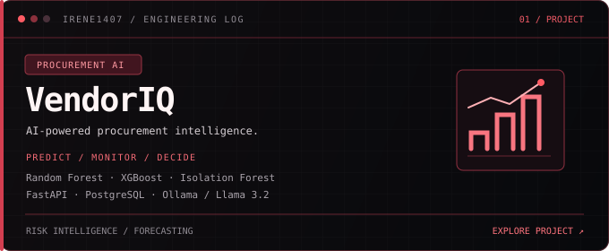
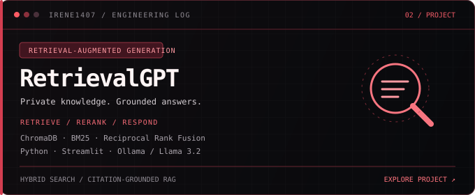
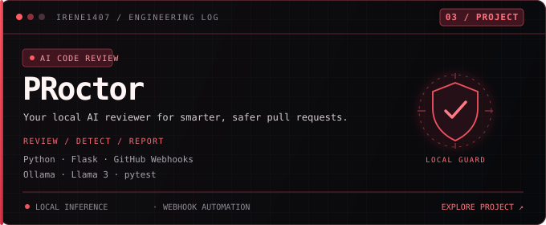

<!-- Profile README image layout. Keep these SVG files in the same folder as README.md. -->

  

  

## `01 / FIELD NOTES`

Aspiring AI/ML Engineer focused on building practical, reliable AI systems, from LLM-powered applications and RAG pipelines to machine learning-driven analytics.

I work at the intersection of Generative AI, intelligent retrieval, and applied machine learning, turning complex ideas into systems that are measurable, explainable, and useful.

My engineering loop: understand → build → evaluate → improve.

  

  

  

<!-- Add your skills, certifications, experience, and contact sections here. -->

## 05 / TECH STACK

**// LANGUAGES & DATA**

**// MACHINE LEARNING & DEEP LEARNING**

**// GENERATIVE AI & RETRIEVAL**

**// BACKEND & DEPLOYMENT**

**// TOOLS & INTERFACES**

## 04 / MILESTONES

- **GREEN TECH HACKATHON | WINNER**  
  Built an AI-driven sustainability solution, competing against 50+ teams.

- **NSRI 72-HOUR RESEARCH HACKATHON | FINALIST**  
  Reached the finalist stage in a global research hackathon with 900+ participants from 35+ countries.

- **MACHINE LEARNING & DEEP LEARNING**  
  Completed specializations from DeepLearning.AI / Stanford Online and the IBM Deep Learning Professional Certificate.

- **GENERATIVE & AGENTIC AI**  
  Earned certifications in Generative AI for Software Developers from IBM SkillsBuild and Agentic AI Engineering from Edureka.

  

